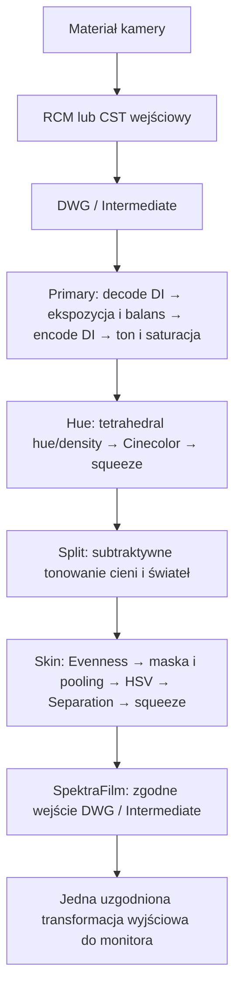

# Primera Merged DWG 1.0.1

Jeden samodzielny DCTL z czterema modułami Primera Suite v0.6.0: Primary, Hue, Split i Skin. Wejście i wyjście: **DaVinci Wide Gamut / DaVinci Intermediate**. Plik nie wykonuje konwersji gamutu ani transformacji do monitora.

Źródło zweryfikowane 22.10.2026: [Primera Suite](https://github.com/geoffsmithBK/primera-suite/tree/5b24e593390095968159e9ca55802feb0b35b64c), commit `5b24e593390095968159e9ca55802feb0b35b64c`. Cztery pliki w repozytorium są zgodne z połączeniem fragmentów wskazanych w jego Makefile. Pełna licencja MIT Geoffa Smitha jest w pliku DCTL oraz LICENSE.txt. To niezależne scalenie, nie oficjalne wydanie autora.

## Poprawka 1.0.1

Wersja 1.0 zgłosiła w Resolve błąd „wrong argument PrimeraParams u in Transform DCTL”. W 1.0.1 zmieniono nazwy pomocnicze P/H/S/K_transform na P/H/S/K_process, aby słowo `transform` występowało wyłącznie przy właściwej funkcji wejściowej. Prawdopodobną przyczyną jest rozpoznawanie nazw pomocniczych przez parser jako funkcji wejściowych. Poprawka nie zmienia matematyki. Jej kompilacja w Resolve pozostaje niepotwierdzona.

Panel jest płaską listą, bez wizualnych grup. Prefiksy służą wyłącznie rozpoznaniu modułu.

## Instalacja

1. W DaVinci Resolve Studio otwórz Project Settings → Color Management → Lookup Tables → Open LUT Folder.
2. Utwórz tam folder `PrimeraMergedDWG`. Skopiuj do niego `PrimeraMergedDWG.dctl` i `LICENSE.txt`. Nie trzeba kopiować oryginalnych modułów ani dodatkowych nagłówków.
3. Kliknij Update Lists. Jeśli nowy plik nie pojawi się na liście, uruchom Resolve ponownie.
4. Na stronie Color dodaj szeregowy węzeł, przeciągnij na niego efekt **Resolve FX Color → DCTL** i wybierz `PrimeraMergedDWG` z DCTL List. Używaj efektu DCTL z kontrolkami, nie pozycji LUT pozbawionej interaktywnego panelu.
5. Dopilnuj, aby do węzła docierał już DWG/Intermediate: przez zarządzanie kolorem projektu albo wcześniejszy CST z właściwej przestrzeni kamery. W CST wejściowym nie wykonuj dodatkowej konwersji do Rec.709.
6. Po wymianie kodu w już załadowanym efekcie użyj resetu obok DCTL List, który według dokumentacji przebudowuje kod. Nie myl go z resetem wszystkich parametrów efektu. W starszych wersjach interfejs może mieć Reload DCTL.

Przy błędzie kompilacji zachowaj pełny tekst okna DCTL Build Error wraz z wersją Resolve i typem GPU. Plik przeszedł testy zastępcze CPU, ale nie został skompilowany ani wyrenderowany przez Resolve.

## Interfejs zamiast tabs

Dokumentacja `DCTLReadme.txt` dostarczona przez konektor Resolve Studio 21.1.1 opisuje sześć typów kontrolek: suwak float, suwak int, pole wartości, checkbox, combo box i próbnik koloru. Nie udostępnia tabs, grup zwijanych ani warunkowego ukrywania kontrolek. Limit wynosi 64 kontrolki każdego z pierwszych pięciu typów oraz 5 próbników.

Ten plik używa **49 suwaków float i 17 checkboxów**. Razem 66, ale limit dotyczy każdego typu osobno, więc nie jest przekroczony.

- `Primary - ...`, `Hue - ...`, `Split - ...`, `Skin - ...` są wyłącznie prefiksami etykiet, nie wizualnymi grupami. Wszystkie kontrolki pozostają widoczne; Resolve może układać typy kontrolek osobno.
- `Enable Primary/Hue/Split/Skin` przełączają przetwarzanie odpowiednich sekcji i zachowują ich ustawienia.
- `Bypass All` zwraca dokładnie wejściowe RGB i wyłącza również podglądy diagnostyczne.
- Wyłączenie sekcji nie chowa jej suwaków. Nie ma pozorowanej zakładki, która nadpisywałaby wspólne suwaki i gubiła stan innych modułów.
- Funkcja transferu Primary i Split jest na stałe ustawiona na DaVinci Intermediate. To świadomie wersja tylko dla DWG/Intermediate.

Jeśli wymagane są prawdziwe strony panelu, potrzebny jest osobny **Fusion Fuse/makro z kontrolkami stron** i implementacją przetwarzania albo **plugin OFX** z grupami/stronami parametrów. OFX definiuje `kOfxParamTypeGroup` i `kOfxParamTypePage`, ale wygląd zależy od hosta. Nie da się dodać takiego panelu do natywnego DCTL samą deklaracją tabs. Wariant Fusion wymaga także jawnego dopilnowania przestrzeni kolorów na wejściu i wyjściu; nie jest automatycznie zamiennikiem węzła Color.

## Kolejność operacji

Każdy wyłączony moduł jest pomijany, pozostałe zachowują tę samą kolejność. Dołączony `KOLEJNOSC.svg` pokazuje również sposób próbkowania sąsiadów przez Skin.

## Jak pracować

Zacznij od ekspozycji, Temp/Tint i umiarkowanego kontrastu w Primary. Następnie kształtuj rodziny barw w Hue, dodaj delikatny Split i dopracuj skórę w Skin. `Protect Skintones` w Hue dotyczy oryginalnej operacji Cinecolor, nie stanowi ogólnej ochrony przed wszystkimi korekcjami.

Skin zachowuje Soften i Separation. Dla każdego sąsiedniego piksela używanego przez maskę ponownie liczone są Primary, Hue i Split. Dzięki temu maska widzi obraz po tych modułach, a nie surowe wejście do scalonego węzła. To kosztowniejsze niż cztery węzły z pośrednimi obrazami GPU. Soften = 0 nie wyłącza próbkowania przestrzennego, jeśli Separation > 0. Przy 0 < Soften < 0.5 i aktywnym Separation oryginalny algorytm może wykonywać dwa przebiegi poolingu.

Na początek zostaw Soften i Separation na 0. Podnieś je dopiero, gdy obraz wymaga korekcji maski albo separacji tła. Wydajność w 4K wymaga sprawdzenia na GPU użytkownika.

Show Chart, Show Ramp, Show Curve, Show Pivot, Show Mask i Legend to elementy obrazu, nie osobna warstwa interfejsu. Wyłącz je przed eksportem. Diagnostyka wcześniejszego modułu przechodzi przez późniejsze moduły, tak jak przy szeregowym połączeniu oryginałów; do oglądania jej bez dalszych zmian wyłącz kolejne sekcje.

Zachowane zostały oryginalne ograniczenia i estetyka algorytmów: Hue pomija piksele z kanałem poza 0–1; Skin stosuje maskowany soft squeeze, więc ustawienia domyślne nie są gwarancją idealnego passthrough dla całego HDR i wartości ujemnych. Do pewnego porównania z wejściem służy Bypass All. Zachowano także oryginalne współczynniki funkcji luminancji, w tym funkcji nazwanej `luminance_dwg`; nie zastępowano ich inną metryką kolorymetryczną DWG.

Nie eksportuj aktywnego przestrzennego Skin do LUT 3D. Najbezpieczniej wyłączyć sekcję Skin przy eksporcie LUT; przestrzenne Soften i Separation nie są reprezentowalne w LUT.

## SpektraFilm na końcu

Umieść SpektraFilm po tym DCTL jako końcowy etap kreatywny. Jego wejście musi odpowiadać rzeczywistemu **DWG/Intermediate**, nie przestrzeni kamery sprzed CST. Nazwy i zakres ustawień zależą od wersji SpektraFilm.

- **Projekt zarządzany kolorem:** wybierz w SpektraFilm tryb RCM/ACES i przestrzeń roboczą DWG/Intermediate, jeżeli Twoja wersja udostępnia taką konfigurację wejścia/wyjścia. Transformację do monitora pozostaw projektowi. Autor zaznacza, że wyjście tego trybu nie jest fizycznie czystym scene-referred ze względu na konwersję gęstości odbitki.
- **Projekt DaVinci YRGB z ręcznymi CST:** CST wejściowy → scalony DCTL → SpektraFilm. Jeżeli SpektraFilm wyprowadza już Rec.709/Gamma 2.4, nie dokładaj po nim CST DWG → Rec.709. Jeżeli oddaje DWG/Intermediate, dopiero potem zastosuj właściwy CST wyjściowy.

Nie zakładaj automatycznie, że każdy tryb SpektraFilm oddaje tę samą przestrzeń co wejście. Ustawienia I/O trzeba uzgodnić dla wybranego trybu. Nie dołączono ani nie zmodyfikowano kodu SpektraFilm.

## Źródła API i workflow

- Blackmagic Design: `DCTLReadme.txt`, sekcje typów, sygnatur transform i „Using DCTLs as Effects With Custom UI”; dokument odczytany z konektora Resolve 21.1.1 dnia 22.10.2026. Brak testu działania panelu w aplikacji.
- [Fusion Fuse SDK](https://documents.blackmagicdesign.com/UserManuals/Fusion_Fuse_SDK.pdf).
- [OpenFX: parametry, grupy i strony](https://openfx.readthedocs.io/en/main/Reference/ofxParameter.html).
- [SpektraFilm: opis zarządzania kolorem](https://spektrafilm.114c.de/technical/).
- [SpektraFilm: historia wdrożenia trybu RCM/ACES](https://spektrafilm.114c.de/changelog/).

Szczegóły testów i ograniczenia: `TESTY_PL.md`.
